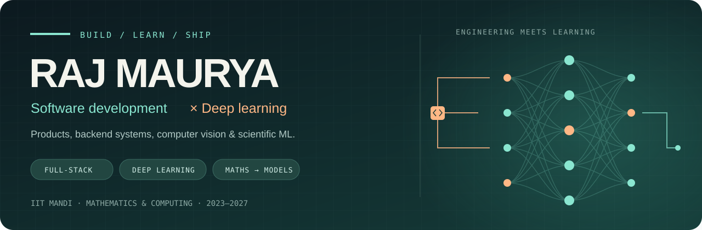
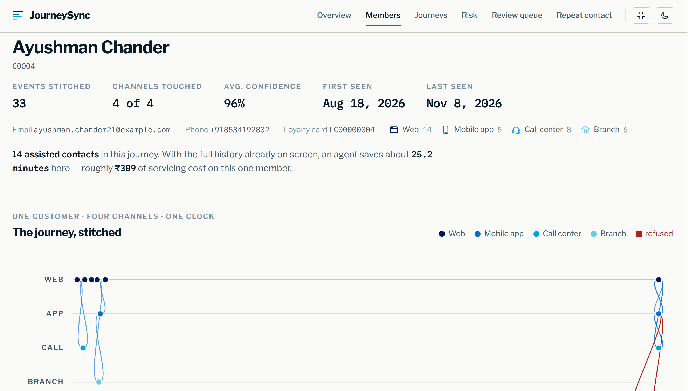
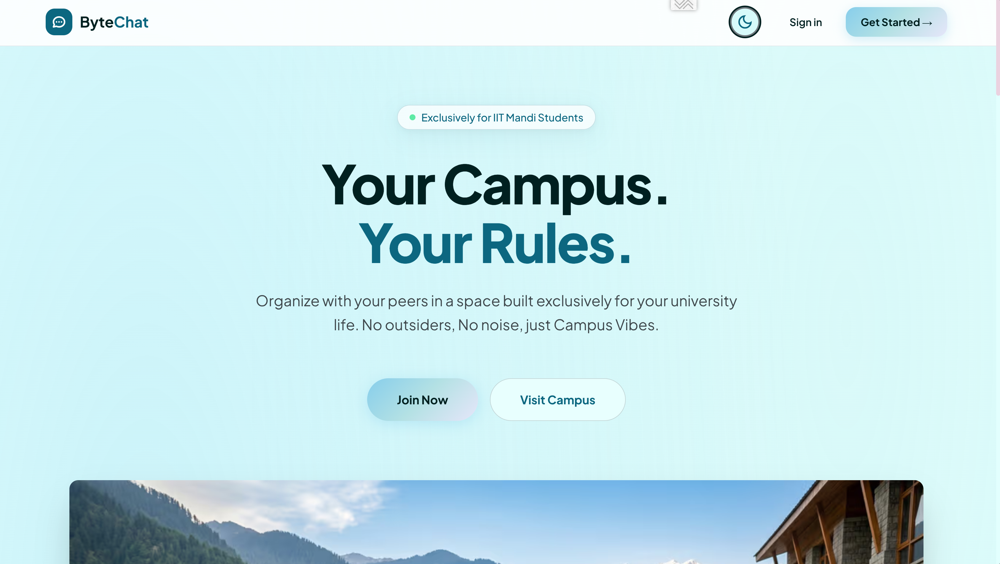
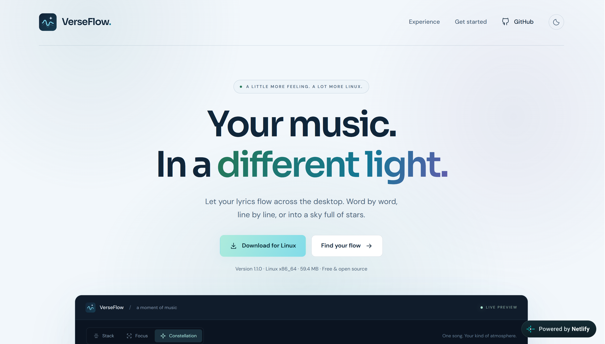
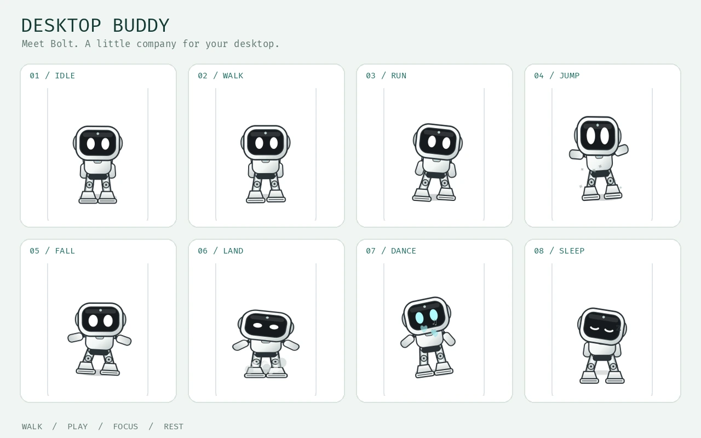

<p align="center">
  
</p>

<p align="center">
  <b>Software Developer · Deep Learning Engineer</b><br/>
  B.Tech Mathematics &amp; Computing · IIT Mandi · 2023–2027
</p>

<p align="center">
  <a href="https://rajm012.vercel.app"><b>🌐 Portfolio</b></a> &nbsp; / &nbsp;
  <a href="https://rajm012.vercel.app/projects"><b>🛠 Projects</b></a> &nbsp; / &nbsp;
  <a href="https://rajm012.vercel.app/Raj-Maurya-Resume.pdf"><b>📄 Résumé</b></a> &nbsp; / &nbsp;
  <a href="https://www.linkedin.com/in/raj-maurya-271b32237/"><b>LinkedIn</b></a> &nbsp; / &nbsp;
  <a href="mailto:rajmahimaurya@gmail.com"><b>Say hello</b></a>
</p>

I build **software people can use** and **deep learning models you can evaluate**. My work spans full-stack products, backend systems, desktop applications, computer vision and scientific ML. Mathematics gives me tools for diagnosing a problem; engineering turns the solution into something that runs.

| 🏁 AMEX CodeStreet 2026 | 🛠 Repository catalog | 🧠 Deep learning papers | 🎓 IIT Mandi |
|:---:|:---:|:---:|:---:|
| **Top 6 finalist** | **31 repositories** | **2 under review** | **8.73 / 10 CGPA** |

## ⚡ Build things. Train models. Make them work.

<table>
<tr>
<td width="50%" valign="top">
<h3>🛠 Software engineering</h3>
<p>Product requirements → system design → implementation → testing → delivery.</p>
<p>Full-stack applications, streaming dashboards, collaborative tools, Linux desktop apps and production feature delivery.</p>
<p><b>React · Next.js · Node.js · FastAPI · PostgreSQL · Docker</b></p>
</td>
<td width="50%" valign="top">
<h3>🧠 Deep learning engineering</h3>
<p>Problem formulation → data and physics → model design → training → evaluation.</p>
<p>Computer vision, contrastive learning, physics-informed neural networks and stochastic market models.</p>
<p><b>PyTorch · TensorFlow · OpenCV · PINNs · NumPy / SciPy</b></p>
</td>
</tr>
</table>

**How I work:** problem diagnosis · solution design · trade-off analysis · agile delivery.

## 🚀 A few things I’ve shipped

<table>
<tr>
<td width="33%" valign="top">
<a href="https://github.com/rajm012/JourneySync"></a>
<h3>JourneySync</h3>
<p>Cross-channel identity resolution and customer journey stitching. Team Cinephiles, <b>AMEX CodeStreet 2026 finalist</b>.</p>
<p>Python · PostgreSQL · TypeScript · Docker</p>
</td>
<td width="33%" valign="top">
<a href="https://bytechat.in"></a>
<h3>ByteChat</h3>
<p>Anonymous, encrypted chat for the IIT Mandi community. A product with real users and a live home at <a href="https://bytechat.in">bytechat.in</a>.</p>
<p>Next.js · Supabase · PostgreSQL · AWS</p>
</td>
<td width="33%" valign="top">
<a href="https://verseflow-linux.netlify.app/"></a>
<h3>VerseFlow</h3>
<p>Animated lyrics synchronized with Linux music players. A Linux adaptation of the open-source <b>Constelyric</b> project.</p>
<p>Python · PyQt6 · MPRIS · D-Bus</p>
</td>
</tr>
</table>

## 📄 Projects from my résumé

| Project | What I built | Stack |
|---|---|---|
| [**GenWeb**](https://github.com/rajm012/GenWeb) | Collaborative AI website builder: natural-language briefs, agent-driven scaffolding, build and deployment, live previews and authentication. | Next.js · React · Supabase · Clerk · LLM agents |
| [**NetSentinel**](https://github.com/rajm012/NetSentinel) | Streaming network telemetry, anomaly and threat detection, and operator dashboards that turn packet data into actionable alerts. | FastAPI · React · Scapy · Python |
| [**MovieFlix**](https://github.com/rajm012/MovieFlix) | Full-stack ticket booking and theatre operations: seat selection, payments, confirmations and separate user and admin workflows. | React · Node.js · Express · MongoDB |
| [**C-TAEA**](https://github.com/rajm012/CTAEA-Implementation) | IEEE TEVC paper replication and constrained multi-objective benchmarks, evaluating convergence, solution diversity and feasibility. | Python · pymoo · Evolutionary algorithms |
| [**Deepfake Detection**](https://github.com/rajm012/Deepfake-Detection) | Unsupervised video detection using facial cues, pseudo-labels and enhanced contrastive learning. | PyTorch · EfficientNet · dlib · MTCNN |

**Hardware, too:** an IoT-enabled **portable oxygen concentrator prototype** for low-resource settings, plus a [path-recording memory robot](https://github.com/rajm012/To-and-Fro-Memory-Robot) with code, CAD and PCB design.

## 🤖 A little company for the desktop

**Desktop Buddy** brings Bolt, Boo-ombastic and Mochi to the Linux desktop: window perching, local reminders, optional media controls and a focus timer. Free and open source, with a Linux download available on [desktop-buddy.netlify.app](https://desktop-buddy.netlify.app/).

<a href="https://rajm012.vercel.app/projects#desktop-buddy">
  
</a>

[**Download for Linux →**](https://desktop-buddy.netlify.app/#download) · [**Source code**](https://github.com/rajm012/Desktop-Buddy) · [**Meet Bolt in the screenshot gallery →**](https://rajm012.vercel.app/projects#desktop-buddy)

## 🧪 Deep learning, with the equations included

My research is part of my deep learning work: choosing representations, building trainable models and checking them against numerical references.

### SAGE-PINN · Under review at Journal of Computational Physics

**A Singularity-free Axisymmetric Geometry-Encoded Physics-Informed Neural Network for Axisymmetric Multiphysics Flow in Cylindrical Coordinates**

Raj Maurya, Joyprakash Akhuli, Doyel Pandey · [arXiv:2610.10449](https://arxiv.org/abs/2610.10449)

Removes the cylindrical-axis singularity by construction using `s = r²`, a modified stream function and exact boundary ansätze. One configuration solves **40 nanofluid cases** from physics alone, with **1.6% axial-velocity error** over the central operating range against finite-element references.

### SAFE-PINN · Under review at Physics of Fluids, special issue

**A Singularity-Free Physics-Informed Neural Network for Electroosmotic Flow in a Cylindrical Nanochannel with Axially Varying Zeta Potential**

Raj Maurya, Doyel Pandey, Somchai Wongwises. Coupled Poisson–Nernst–Planck and Stokes electroosmotic flow, with a model designed around the governing equations. Full manuscript and source code remain private.

[**Paper previews and research details →**](https://rajm012.vercel.app/research)

## 🔭 On my workbench

| Work | Direction |
|---|---|
| [**Neuro-Trade via PINNs**](https://github.com/rajm012/Neuro-Trade-via-PINNs) | Indian market dynamics through SDEs, Fokker–Planck equations and learned drift/diffusion. |
| **EXOCORTEX** | A personal knowledge bank and digital-twin direction: books, films, study, projects, topic maps and a time ledger. |
| **Neural-network superhedging** | Paper replication and pricing experiments, with dynamic-method validation in progress. |
| **Paper-based soil analysis** | Exploratory research into low-cost nutrient assays read by a smartphone camera. |
| [**Blood-flow PINNs**](https://github.com/rajm012/Blood-flow-via-PINNs) / [**Wavy-channel PINNs**](https://github.com/rajm012/Unsupervised-PINNs-for-Flow-Dynamics-in-Wavy-Channel) | Public fluid-dynamics replications with COMSOL references and ongoing evaluation. |

## 🧭 Experience that shapes how I build

**Software Development Intern · Pinch · May–July 2026**

- Shipped and tested production features within an agile engineering team.
- Translated product requirements into scoped, reviewable delivery increments.
- Validated releases with design and QA, documenting edge cases before handoff.

**Teaching Assistant · Himshikhar, IIT Mandi · May–July 2026**

- Mentored undergraduate cohorts and explained concepts to mixed audiences.
- Supported course delivery and assessment under fixed academic deadlines.
- Managed competing priorities across concurrent student groups.

**Deep Learning Research · IIT Mandi, with Dr. Doyel Pandey · 2026–present**

Model design and evaluation for physics-informed fluid dynamics; SAGE-PINN and SAFE-PINN are both under review.

**Research Intern · IIT Mandi · December 2024–January 2025**

Studied NP-complete classes, formal reductions and approximation, decomposing hard problems into tractable sub-problems.

**Research Society, IIT Mandi · Member since 2024**

## 🧰 Toolbox

| Area | Tools & ideas |
|---|---|
| Languages | Python · C++ · JavaScript / TypeScript · Bash · SQL |
| Software & cloud | React · Next.js · React Native · Node.js · Express · GraphQL · FastAPI · Flask · Docker · Git · Linux |
| Data | PostgreSQL · Supabase · MongoDB · NumPy · SciPy · pandas |
| Deep learning & vision | PyTorch · TensorFlow · Keras · scikit-learn · OpenCV · contrastive learning |
| Mathematical modelling | PINNs · ODEs / PDEs · SDEs · Fokker–Planck · optimisation · stochastic modelling |
| Scientific computing | COMSOL Multiphysics · MATLAB · Qiskit · pymoo · quantitative finance |

**Education:** B.Tech Mathematics & Computing, IIT Mandi, 2023–2027 · **CGPA 8.73/10**. Coursework includes DSA, linear algebra, optimisation, mathematical modelling, ML, deep learning, ODEs/PDEs, probability and statistics, computer networks and quantitative finance.

**Certifications:** [Machine Learning](public/certificates/Coursera-ML.pdf), Coursera / Andrew Ng · [Quantum Computing](public/certificates/Coursera-QC.pdf), Coursera · [Dynamic Programming](public/certificates/Coursera-DP.pdf), Coursera.

**Away from the terminal:** Hindi sahitya, philosophy, films, music, running and cycling. English / Hindi.

<details>
<summary><b>📦 Full repository catalog · 23 public + 8 private</b></summary>

Checked on 8 November 2026. Every owned repository is included, with private work described without source links.

| Repository | What it is | Visibility |
|---|---|---|
| [JourneySync](https://github.com/rajm012/JourneySync) | Cross-channel identity resolution · AMEX CodeStreet 2026 finalist | Public |
| [Byte-Chat](https://github.com/rajm012/Byte-Chat) | Anonymous, encrypted chat for the IIT Mandi community | Public |
| [CTAEA-Implementation](https://github.com/rajm012/CTAEA-Implementation) | C-TAEA implementation and constrained multi-objective benchmarks | Public |
| [Deepfake-Detection](https://github.com/rajm012/Deepfake-Detection) | Unsupervised deepfake detection through contrastive learning | Public |
| [VerseFlow](https://github.com/rajm012/VerseFlow) | Animated, synchronized lyrics for Linux · adaptation of Constelyric | Public |
| [NetSentinel](https://github.com/rajm012/NetSentinel) | Network traffic monitoring and threat detection | Public |
| Stenosis-On-Polar-Coords | SAGE-PINN · axisymmetric nanofluid flow and heat transfer | Private |
| POF-Comp | SAFE-PINN · electroosmotic flow in cylindrical nanochannels · under review | Private |
| [Blood-flow-via-PINNs](https://github.com/rajm012/Blood-flow-via-PINNs) | Near-wall blood-flow recovery from sparse sensors | Public |
| [Unsupervised-PINNs-for-Flow-Dynamics-in-Wavy-Channel](https://github.com/rajm012/Unsupervised-PINNs-for-Flow-Dynamics-in-Wavy-Channel) | PINN replication of flow in a wavy-patterned channel | Public |
| Paper-Devices | Exploratory research into smartphone-readable soil assays | Private |
| Super-Hedging-Via-Neural-network | Neural-network superhedging replication and pricing experiments | Private |
| Trade | Chart-pattern detection for Indian equities | Private |
| [Neuro-Trade-via-PINNs](https://github.com/rajm012/Neuro-Trade-via-PINNs) | SDEs and Fokker–Planck PINNs for Indian equities | Public |
| [Traffic-Flow-Simulation](https://github.com/rajm012/Traffic-Flow-Simulation) | LWR traffic modelling, LSTM prediction and shock-wave simulation | Public |
| [GenWeb](https://github.com/rajm012/GenWeb) | Collaborative fork of an AI website builder | Public |
| EXOCORTEX | Personal knowledge bank, deterministic imports and a time ledger | Private |
| [YT-WrapUp](https://github.com/rajm012/YT-WrapUp) | Interactive 3-D visualisation of YouTube watch history | Public |
| [Check-It](https://github.com/rajm012/Check-It) | In-browser object detection with TensorFlow.js and COCO-SSD | Public |
| [Self-Driving-Car](https://github.com/rajm012/Self-Driving-Car) | Browser-based neural-network driving simulation | Public |
| [Basic-Image-Classification](https://github.com/rajm012/Basic-Image-Classification) | KNN sketch classification with parallel browser evaluation | Public |
| [Chit-Chat](https://github.com/rajm012/Chit-Chat) | Collaborative documents, teams, chat and notifications | Public |
| [BlogsCorner](https://github.com/rajm012/BlogsCorner) | Blog publishing and discovery platform | Public |
| [MovieFlix](https://github.com/rajm012/MovieFlix) | Movie-ticket booking, seat selection and payments | Public |
| [Ethical-Keylogger](https://github.com/rajm012/Ethical-Keylogger) | Activity-monitoring tool for parental control | Public |
| [Desktop-Buddy](https://github.com/rajm012/Desktop-Buddy) | Animated Linux companions, reminders and a focus timer · [Website & download](https://desktop-buddy.netlify.app/) | Public |
| [Rajm012](https://github.com/rajm012/Rajm012) | This React, Vite and Tailwind portfolio | Public |
| resumes | Private résumé source documents; current public PDF linked above | Private |
| [Quant-Finance](https://github.com/rajm012/Quant-Finance) | MA-546 and MA-653 finance assignments, market analysis and reports | Public |
| Fin-Eng--Assignment-1 | Martingales, Brownian motion, Markov chains and Monte Carlo | Private |
| [To-and-Fro-Memory-Robot](https://github.com/rajm012/To-and-Fro-Memory-Robot) | Path-recording robot · code, CAD and PCB design | Public |

</details>

[**Browse all 31 repositories with search and category filters →**](https://rajm012.vercel.app/projects)

<details>
<summary><b>🛠 Run this portfolio locally</b></summary>

```bash
npm ci
npm run dev
npm run lint
npm run build
```

Project summaries, images, galleries, repository names and visibility live in `src/data/projects.js`. Research study links use the same catalog. Recheck GitHub when a repository is added, removed or changes visibility.

</details>

---

<p align="center">
  <b>Have a product to ship or a model to build?</b><br/>
  Open to software development and deep learning roles, and collaborations in computer vision and scientific computing.<br/>
  <a href="mailto:rajmahimaurya@gmail.com">rajmahimaurya@gmail.com</a> · <a href="https://www.linkedin.com/in/raj-maurya-271b32237/">LinkedIn</a>
</p>
